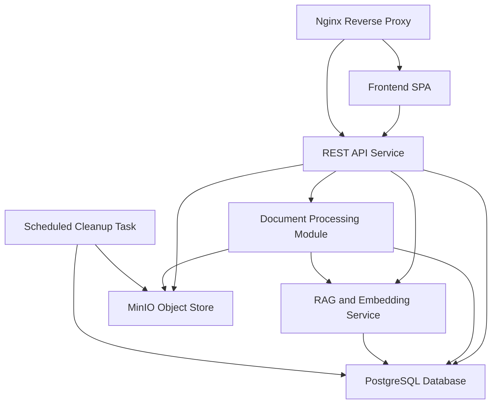
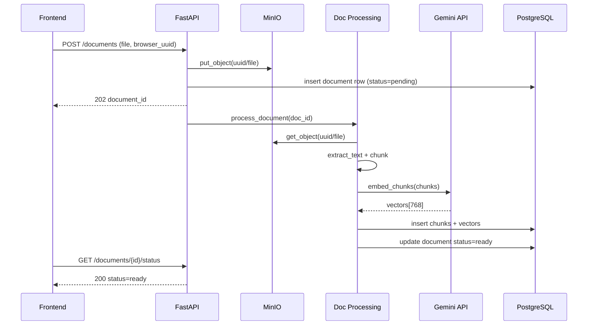
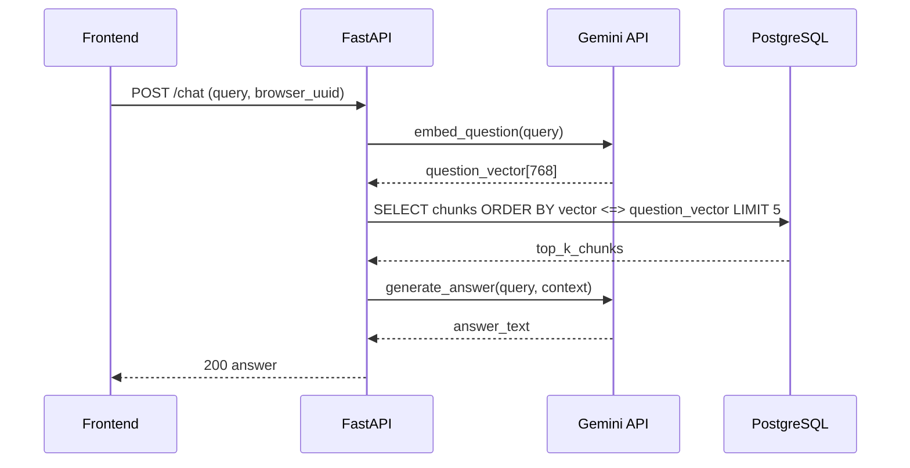
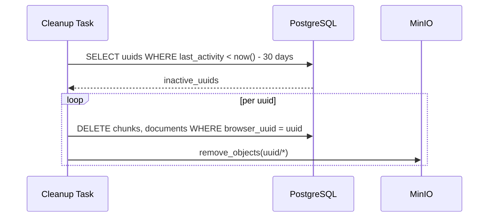
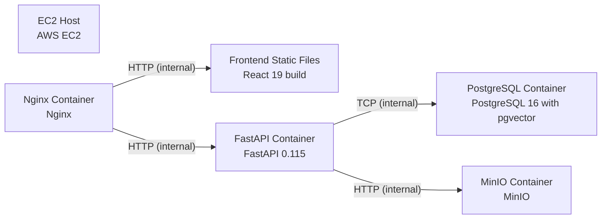

# Architecture

> Maintained by QuorQ AI SDLC. Text between `sdlc:auto` markers is regenerated; anything outside them is yours and is kept.

<!-- sdlc:auto:start narrative -->
## Overview

### ARCH-OVERVIEW · approved · source: architecture:summary

Approved architecture (version 2) for a lightweight, login-free RAG chatbot. Users are identified by a browser-generated UUID in localStorage; documents are uploaded, chunked, embedded, and queried via Gemini models; history lives only in the browser.

System summary: no-login RAG chatbot. Identity is a browser-generated UUID (crypto.randomUUID) stored in localStorage -- no server-side auth. Documents (PDF, TXT, DOCX) are uploaded via a React 19 SPA, stored in MinIO, parsed/chunked server-side, embedded with gemini-embedding-001 (768 dimensions), and stored in PostgreSQL 16 with pgvector. Chat questions are embedded, matched via cosine similarity search, and answered by Gemini 2.5 Flash grounded in retrieved chunks without citation markers. Conversation history persists only in browser localStorage (not server-side). A scheduled cleanup task removes data for browser UUIDs inactive ~30 days. Deployment is Docker containers on a single AWS EC2 instance, with Nginx serving the React static build and reverse-proxying /api to FastAPI. Status: approved, version 2.

- ⚠ No explicit mapping provided between architecture elements and the 18 known requirement keys (US-001..US-018); traceability_matrix cannot be populated from this input alone.
- ⚠ No industry/compliance domain was named for this project, so no regulatory trace was performed.

### ARCH-COMP-FE · approved · source: architecture:component:fe

React 19 single-page application providing the chat UI, file upload widget, browser UUID generation, and localStorage-based history.

Component: Frontend SPA (fe), React 19. Responsibilities: renders chat interface and file upload widget; generates browser UUID via crypto.randomUUID; persists conversation history in localStorage. Explicitly no server-side rendering, no authentication UI, and no routing complexity. Communicates with the api component over REST.

**Related:** ARCH-COMP-API

- ⚠ No detail on UI states (loading/error) or accessibility considerations provided.

### ARCH-COMP-API · approved · source: architecture:component:api

FastAPI 0.115 REST service that orchestrates document upload, status polling, listing, and chat query pipelines.

Component: REST API Service (api), FastAPI 0.115. Exposes endpoints for document upload, upload status polling, document listing, and chat queries. Validates file formats, orchestrates document processing and RAG pipelines, and manages MinIO and PostgreSQL connections. GEMINI_API_KEY is read from server-side environment variables only and never exposed to the client.

**Related:** ARCH-COMP-FE, ARCH-COMP-DOCPROC, ARCH-COMP-RAG, ARCH-COMP-DB, ARCH-COMP-OBJSTORE, ARCH-API-ENDPOINTS

- ⚠ No rate limiting or abuse-prevention strategy described, which is notable given there is no authentication layer.
- ⚠ No stated upload file-size limit or max concurrent processing jobs.

### ARCH-COMP-DOCPROC · approved · source: architecture:component:doc_proc

Server-side module that extracts, chunks, and embeds document text before persisting vectors to PostgreSQL.

Component: Document Processing Module (doc_proc), FastAPI 0.115. Downloads files from MinIO, extracts text from PDF, TXT, and DOCX formats, splits text into chunks of approximately 1000 characters, calls the embedding service (rag component) to produce 768-dimensional vectors, and persists them to PostgreSQL.

**Related:** ARCH-COMP-OBJSTORE, ARCH-COMP-RAG, ARCH-COMP-DB, ARCH-FLOW-UPLOAD

- ⚠ Chunk size is approximate (~1000 characters) with no stated overlap strategy or chunking algorithm detail.
- ⚠ No stated error-handling/retry behavior if text extraction or embedding calls fail mid-document.

### ARCH-COMP-RAG · approved · source: architecture:component:rag

Wrapper around Google Gemini APIs for embedding text and generating grounded chat answers.

Component: RAG and Embedding Service (rag), Google Gemini API. Wraps Gemini API calls for embedding (gemini-embedding-001, 768 dimensions) and answer generation (Gemini 2.5 Flash). Provides functions to embed text chunks, embed user questions, and generate grounded answers from retrieved context passages without citation markers.

**Related:** ARCH-COMP-DOCPROC, ARCH-COMP-API, ARCH-FLOW-CHAT

- ⚠ No stated top-k value for retrieved context passages, nor prompt-template details for grounding.
- ⚠ No fallback behavior described if the Gemini API is unavailable or rate-limited.

### ARCH-COMP-DB · approved · source: architecture:component:db

PostgreSQL 16 with pgvector stores document metadata, chunks, and embedding vectors, keyed by browser UUID, with cosine similarity search for retrieval.

Component: PostgreSQL Database (db), PostgreSQL 16 with pgvector extension. Stores document metadata, text chunks, and 768-dimensional embedding vectors keyed by browser UUID. Provides cosine similarity search for RAG retrieval.

**Related:** ARCH-COMP-DOCPROC, ARCH-COMP-API, ARCH-COMP-CLEANUP, ARCH-DATA-MODEL

- ⚠ No backup/retention policy or index configuration (e.g., ivfflat/hnsw) specified for pgvector.
- ⚠ No stated database migration/versioning approach.

### ARCH-COMP-OBJSTORE · approved · source: architecture:component:object_store

MinIO provides S3-compatible storage for raw uploaded files, organized by browser UUID, retained for reprocessing until cleanup.

Component: MinIO Object Store (object_store). S3-compatible object storage for raw uploaded document files (PDF, TXT, DOCX) organized by browser UUID bucket/prefix. Files are retained for reprocessing and deleted during cleanup.

**Related:** ARCH-COMP-DOCPROC, ARCH-COMP-API, ARCH-COMP-CLEANUP

- ⚠ No stated bucket access-policy or encryption-at-rest configuration.

### ARCH-COMP-CLEANUP · approved · source: architecture:component:cleanup

Periodic background task in the FastAPI process that purges data for browser UUIDs inactive for about 30 days.

Component: Scheduled Cleanup Task (cleanup), FastAPI 0.115 background task. Identifies browser UUIDs with no activity for approximately 30 days and removes their documents, chunks, vectors, and raw files from PostgreSQL and MinIO.

**Related:** ARCH-COMP-DB, ARCH-COMP-OBJSTORE, ARCH-FLOW-CLEANUP

- ⚠ The 30-day inactivity threshold is stated as approximate; exact schedule/frequency of the cleanup job and precise threshold are not specified.
- ⚠ No confirmation of whether cleanup is irreversible/permanent deletion vs. soft delete.

### ARCH-COMP-WEB · approved · source: architecture:component:web

Nginx serves the built React static files and reverse-proxies API traffic to the FastAPI container.

Component: Nginx Reverse Proxy (web). Serves the React static build from the built dist directory and reverse-proxies /api requests to the FastAPI container on its internal port.

**Related:** ARCH-COMP-FE, ARCH-COMP-API, ARCH-DEPLOYMENT

- ⚠ No mention of TLS/HTTPS termination or certificate management for the single EC2 instance.

### ARCH-FLOW-UPLOAD · approved · source: architecture:critical_path:Document Upload and Processing

End-to-end flow for uploading and processing a document into searchable vector chunks.

Critical path: Document Upload and Processing. User selects a file in the SPA; frontend sends it with the browser UUID to the API; API stores it in MinIO; API extracts and chunks text; each chunk is embedded via Gemini; vectors and metadata are persisted to PostgreSQL. The frontend polls for processing status via GET /api/documents/{document_id}/status.

**Related:** ARCH-COMP-FE, ARCH-COMP-API, ARCH-COMP-OBJSTORE, ARCH-COMP-DOCPROC, ARCH-COMP-RAG, ARCH-COMP-DB

### ARCH-FLOW-CHAT · approved · source: architecture:critical_path:Chat Query with RAG

End-to-end flow for answering a user's chat question using retrieval-augmented generation scoped to their browser UUID.

Critical path: Chat Query with RAG. User sends a question from the SPA with their browser UUID. API embeds the question via Gemini, performs cosine similarity search against stored vectors for that UUID, passes top-k chunks as context to Gemini 2.5 Flash, and returns the generated answer without citations.

**Related:** ARCH-COMP-FE, ARCH-COMP-API, ARCH-COMP-RAG, ARCH-COMP-DB

- ⚠ Exact value of 'top-k' retrieved chunks is not specified in the input.

### ARCH-FLOW-CLEANUP · approved · source: architecture:critical_path:Inactive User Data Cleanup

Scheduled process that deletes all data belonging to browser UUIDs inactive for roughly 30 days.

Critical path: Inactive User Data Cleanup. A scheduled task runs periodically, finds browser UUIDs whose latest activity is older than 30 days, deletes their document rows, chunk rows, and vector rows from PostgreSQL, and removes raw files from MinIO.

**Related:** ARCH-COMP-CLEANUP, ARCH-COMP-DB, ARCH-COMP-OBJSTORE

- ⚠ Schedule/frequency of the periodic run is not specified (e.g., hourly, daily).

### ARCH-DATA-MODEL · approved · source: architecture:entities

Three entities back the system: documents, chunks, and user_activity, all keyed by browser UUID.

Entities: (1) documents -- id, browser_uuid, filename, file_type, file_size_bytes, minio_object_key, status, chunk_count, created_at, last_activity_at. (2) chunks -- id, document_id, browser_uuid, chunk_index, content, embedding, created_at. (3) user_activity -- browser_uuid, last_activity_at. These support document tracking, vector storage, and the cleanup task's inactivity lookup.

**Related:** ARCH-COMP-DB, ARCH-COMP-DOCPROC, ARCH-COMP-CLEANUP

- ⚠ No explicit foreign-key/index strategy or embedding dimensionality constraint enforcement described beyond '768-dimensional'.

### ARCH-API-ENDPOINTS · approved · source: architecture:endpoints

Five REST endpoints cover document upload, status, listing, deletion, and chat querying.

Endpoints: POST /api/documents -- upload a document (PDF, TXT, DOCX); returns document ID and initial status. GET /api/documents/{document_id}/status -- poll processing status of an uploaded document. GET /api/documents -- list all documents belonging to the browser UUID. DELETE /api/documents/{document_id} -- delete a document and its chunks/vectors for the browser UUID. POST /api/chat -- send a question and receive a RAG-grounded answer from retrieved document chunks.

**Related:** ARCH-COMP-API, ARCH-COMP-DOCPROC, ARCH-COMP-RAG, ARCH-FLOW-UPLOAD, ARCH-FLOW-CHAT

- ⚠ No request/response schema details (field names, status codes) given beyond endpoint purpose.
- ⚠ No explicit authentication/authorization check described for scoping endpoints to the requesting browser UUID (e.g., how server verifies UUID ownership).

### ARCH-DEPLOYMENT · approved · source: architecture:deployment_nodes

Single AWS EC2 Ubuntu 22.04 host runs all components as Docker containers: Nginx, FastAPI, PostgreSQL+pgvector, and MinIO.

Deployment nodes: EC2 Host (AWS EC2, Ubuntu 22.04) hosting: Nginx Container (Docker) serving Frontend Static Files (React 19 build, Nginx-served static dist); FastAPI Container (FastAPI 0.115, Docker/uvicorn); PostgreSQL Container (PostgreSQL 16 with pgvector, Docker); MinIO Container (Docker). All containers run on the same single EC2 instance.

**Related:** ARCH-COMP-WEB, ARCH-COMP-API, ARCH-COMP-DB, ARCH-COMP-OBJSTORE, ARCH-TECH-DECISIONS

- ⚠ No stated orchestration tool (e.g., Docker Compose file) confirmed explicitly, though described as 'Docker containers'.
- ⚠ No high-availability, scaling, or backup/disaster-recovery plan for the single-instance deployment.
- ⚠ No TLS/certificate or domain configuration mentioned for the EC2 host.

### ARCH-TECH-DECISIONS · approved · source: architecture:technology_decisions

Four approved technology decisions: React 19 frontend, FastAPI 0.115 backend, PostgreSQL 16 with pgvector, and AWS as the cloud target.

Technology decisions: (1) Frontend: React 19 chosen over Vue 3 and Svelte 5 -- fits a client-rendered SPA with chat UI, file upload, and localStorage history. (2) Backend: FastAPI 0.115 chosen over Flask and Django -- async support pairs well with Gemini API calls and file processing; Pydantic validates upload/chat payloads. (3) Database: PostgreSQL 16 with pgvector chosen over pgvector-on-PostgreSQL-15 and Qdrant -- provides 768-dimensional vector similarity search inside the relational database, avoiding a separate vector service. (4) Cloud: AWS chosen over GCP and Azure -- single EC2 instance with Docker Compose keeps infrastructure simple and cost-effective for MVP. All four marked 'Approved stack'.

**Related:** ARCH-COMP-FE, ARCH-COMP-API, ARCH-COMP-DB, ARCH-DEPLOYMENT

- ⚠ No cost estimate or EC2 instance sizing specified for the MVP deployment.
<!-- sdlc:auto:end narrative -->

<!-- sdlc:auto:start building-blocks -->
## Building Block View

| ID | Name | Technology | Responsibility | Depends on |
|---|---|---|---|---|
| fe | Frontend SPA | React 19 | React 19 single-page application providing the chat interface, file upload widget, browser UUID generation via crypto.randomUUID, and conversation history persistence in localStorage. No server-side rendering, no authentication UI, no routing complexity. | api |
| api | REST API Service | FastAPI 0.115 | FastAPI 0.115 application exposing REST endpoints for document upload, upload status polling, document listing, and chat queries. Validates file formats, orchestrates document processing and RAG pipelines, manages MinIO and PostgreSQL connections. GEMINI_API_KEY is read from server-side environment variables and never exposed to the client. | doc_proc, rag, db, object_store |
| doc_proc | Document Processing Module | FastAPI 0.115 | Server-side module that downloads files from MinIO, extracts text from PDF, TXT, and DOCX formats, splits text into chunks of approximately 1000 characters, and calls the embedding service to produce 768-dimensional vectors before persisting them to PostgreSQL. | rag, db, object_store |
| rag | RAG and Embedding Service | Google Gemini API | Wraps Google Gemini API calls for both embedding (gemini-embedding-001, 768 dimensions) and answer generation (Gemini 2.5 Flash). Provides functions to embed text chunks, embed user questions, and generate grounded answers from retrieved context passages without citation markers. | db |
| db | PostgreSQL Database | PostgreSQL 16 with pgvector | PostgreSQL 16 with the pgvector extension storing document metadata, text chunks, and 768-dimensional embedding vectors keyed by browser UUID. Provides cosine similarity search for RAG retrieval. | — |
| object_store | MinIO Object Store | MinIO | S3-compatible object storage for raw uploaded document files (PDF, TXT, DOCX) organized by browser UUID bucket/prefix. Files are retained for reprocessing and deleted during cleanup. | — |
| cleanup | Scheduled Cleanup Task | FastAPI 0.115 | Periodic background task within the FastAPI process that identifies browser UUIDs with no activity for approximately 30 days and removes their documents, chunks, vectors, and raw files from PostgreSQL and MinIO. | db, object_store |
| web | Nginx Reverse Proxy | Nginx | Nginx serving the React static build from the built dist directory and reverse-proxying /api requests to the FastAPI container on its internal port. | fe, api |

<!-- sdlc:auto:end building-blocks -->

<!-- sdlc:auto:start runtime -->
## Runtime View

### Document Upload and Processing

User selects a file in the SPA, the frontend sends it with the browser UUID to the API, which stores it in MinIO, extracts and chunks text, embeds each chunk via Gemini, and persists vectors and metadata to PostgreSQL. The frontend polls for processing status.

- **Components:** fe, api, object_store, doc_proc, rag, db
- **Modules:** routers.documents, services.file_storage, services.document_parser, services.chunker, services.embedding, models.document, models.chunk
- **Key functions:** upload_document(file, browser_uuid), store_file(uuid, file), extract_text(file_path), chunk_text(text, size=1000), embed_chunks(chunks), persist_chunks(doc_id, chunks, vectors), get_upload_status(doc_id)

### Chat Query with RAG

User sends a question from the SPA with their browser UUID. The API embeds the question via Gemini, performs cosine similarity search against stored vectors for that UUID, passes top-k chunks as context to Gemini 2.5 Flash, and returns the generated answer without citations.

- **Components:** fe, api, rag, db
- **Modules:** routers.chat, services.embedding, services.retrieval, services.generation, models.chunk
- **Key functions:** chat(query, browser_uuid), embed_question(text), similarity_search(vector, uuid, top_k=5), generate_answer(query, context_chunks)

### Inactive User Data Cleanup

A scheduled task runs periodically, finds browser UUIDs whose latest activity is older than 30 days, deletes their document rows, chunk rows, and vector rows from PostgreSQL and removes raw files from MinIO.

- **Components:** cleanup, db, object_store
- **Modules:** tasks.cleanup, services.file_storage
- **Key functions:** find_inactive_uuids(days=30), delete_user_data(uuid), remove_files(uuid)

<!-- sdlc:auto:end runtime -->

<!-- sdlc:auto:start deployment-view -->
## Deployment View

| Name | Service | Runtime | Scaling | Environment |
|---|---|---|---|---|
| EC2 Host | AWS EC2 | Ubuntu 22.04 | single instance | dev |
| Nginx Container | Nginx | Docker | single container | dev |
| Frontend Static Files | React 19 build | Nginx-served static dist | single | dev |
| FastAPI Container | FastAPI 0.115 | Docker (uvicorn) | single container | dev |
| PostgreSQL Container | PostgreSQL 16 with pgvector | Docker | single container | dev |
| MinIO Container | MinIO | Docker | single container | dev |

| Source | Target | Protocol |
|---|---|---|
| Nginx Container | FastAPI Container | HTTP (internal) |
| Nginx Container | Frontend Static Files | HTTP (internal) |
| FastAPI Container | PostgreSQL Container | TCP (internal) |
| FastAPI Container | MinIO Container | HTTP (internal) |

<!-- sdlc:auto:end deployment-view -->

<!-- sdlc:auto:start decisions -->
## Architecture Decisions

| Layer | Choice | ADR |
|---|---|---|
| Frontend | React 19 | [ADR-0001](adr/frontend.md) |
| Backend | FastAPI 0.115 | [ADR-0002](adr/backend.md) |
| Database | PostgreSQL 16 with pgvector | [ADR-0003](adr/database.md) |
| Cloud | AWS | [ADR-0004](adr/cloud.md) |
<!-- sdlc:auto:end decisions -->

<!-- sdlc:auto:start links -->
## Related Documents

- [Data Model](data-model.md)
- [API Specification](api/openapi.yaml)
- [Architecture Decision Records](adr/README.md)
<!-- sdlc:auto:end links -->
