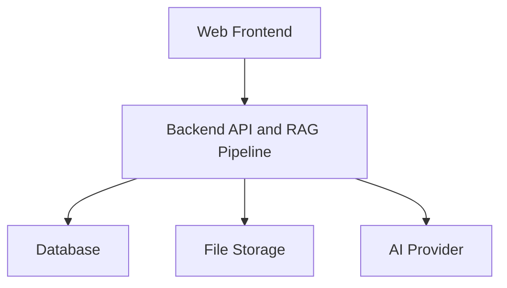
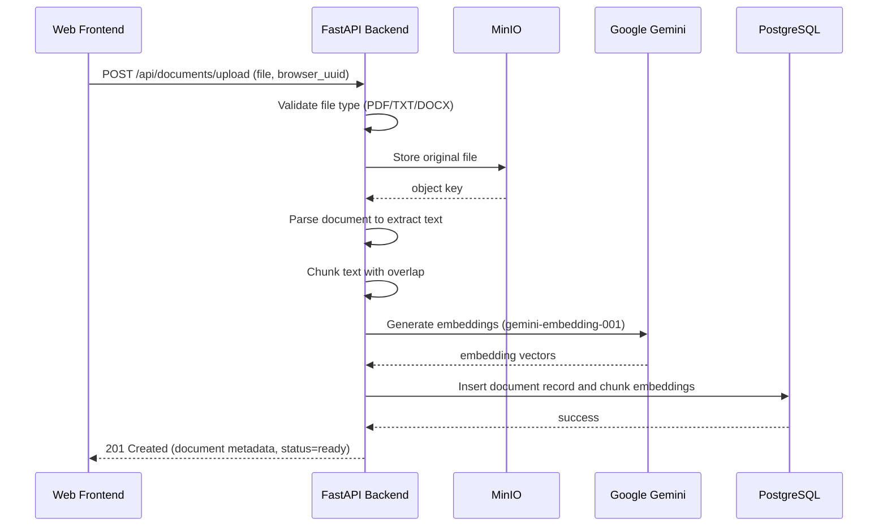
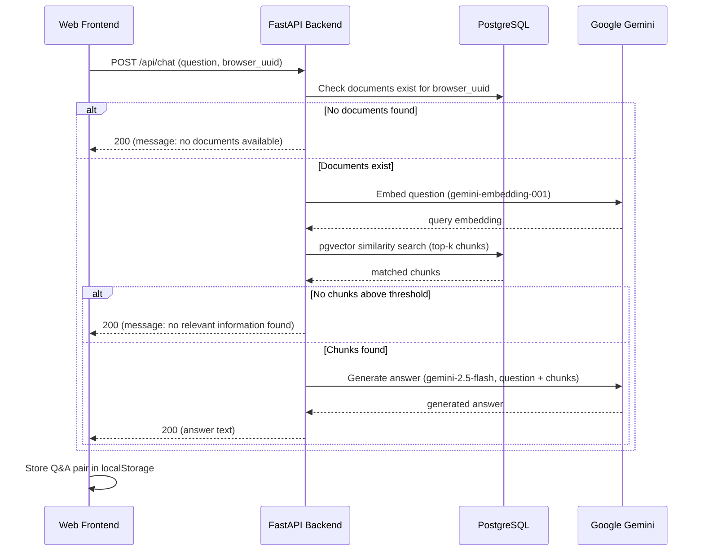
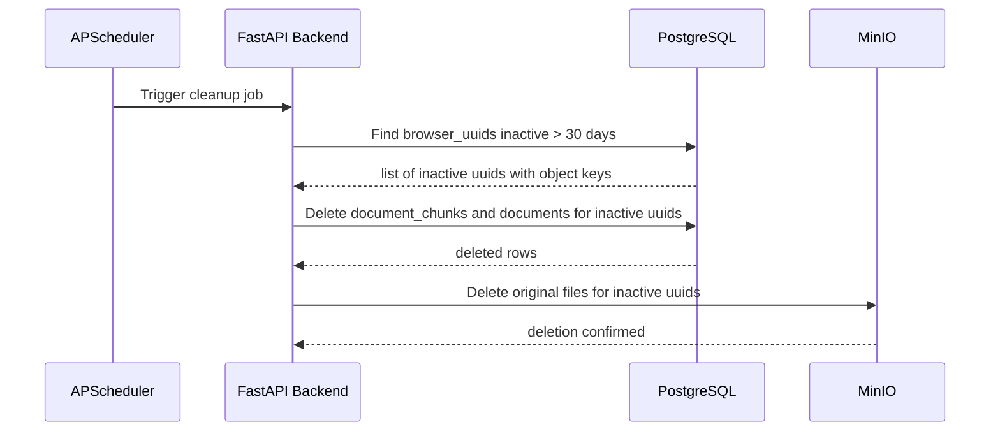
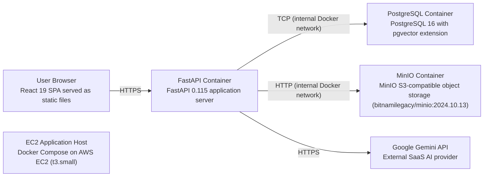

# Architecture

> Maintained by QuorQ AI SDLC. Text between `sdlc:auto` markers is regenerated; anything outside them is yours and is kept.

<!-- sdlc:auto:start narrative -->
## Overview

_No entries for this phase yet._
<!-- sdlc:auto:end narrative -->

<!-- sdlc:auto:start building-blocks -->
## Building Block View

| ID | Name | Technology | Responsibility | Depends on |
|---|---|---|---|---|
| fe | Web Frontend | React 19 | Renders the chat interface and file-upload widget, generates and persists a browser UUID in localStorage, stores and restores conversation history in localStorage, and communicates with the backend REST API for document upload and chat queries. | api |
| api | Backend API and RAG Pipeline | FastAPI 0.115 | Exposes REST endpoints for document upload and chat, parses and chunks uploaded documents, generates embeddings and answers via Google Gemini, stores and retrieves files via MinIO, performs pgvector similarity search, and runs a scheduled cleanup task for inactive data. | db, storage, ai |
| db | Database | PostgreSQL 16 | Stores document metadata (filename, file type, browser UUID, status, timestamps) and document chunk embeddings using the pgvector extension for vector similarity search. | — |
| storage | File Storage | MinIO | Persists original uploaded PDF, TXT, and DOCX files in an S3-compatible object store so returning users can chat against previously uploaded documents without re-uploading. | — |
| ai | AI Provider | Google Gemini | Provides gemini-embedding-001 for document chunk and query embeddings, and gemini-2.5-flash for answer generation grounded in retrieved document content. Access is via server-side API key only. | — |

<!-- sdlc:auto:end building-blocks -->

<!-- sdlc:auto:start runtime -->
## Runtime View

### Document Upload and Processing

A user selects a PDF, TXT, or DOCX file in the web interface and submits it. The backend stores the file in MinIO, parses the text, chunks it with overlap, generates embeddings via gemini-embedding-001, persists embeddings in PostgreSQL with pgvector, and returns document metadata to the frontend.

- **Components:** fe, api, storage, ai, db
- **Modules:** routers.documents, services.file_storage, services.document_parser, services.chunker, services.embedding, models.document
- **Key functions:** upload_document(file, browser_uuid), store_file(file, browser_uuid), parse_pdf(path), parse_docx(path), parse_txt(path), chunk_text(text, chunk_size, overlap), generate_embeddings(chunks), save_chunks(document_id, chunks, embeddings)

### Chat Query with RAG

A user types a question in the chat interface. The frontend sends the question and browser UUID to the backend. The backend embeds the question, performs pgvector similarity search to retrieve relevant chunks, sends the chunks and question to Gemini 2.5 Flash for answer generation, and returns the answer. The frontend stores the Q&A pair in localStorage.

- **Components:** fe, api, ai, db
- **Modules:** routers.chat, services.embedding, services.retrieval, services.generation, models.document
- **Key functions:** chat(question, browser_uuid), check_documents_exist(browser_uuid), generate_query_embedding(question), similarity_search(query_embedding, browser_uuid, top_k), generate_answer(question, retrieved_chunks)

### Inactive Data Cleanup

A scheduled task runs periodically inside the FastAPI process. It queries the database for browser UUIDs whose last activity is older than approximately 30 days, deletes their document chunk embeddings and document records from PostgreSQL, and removes the corresponding original files from MinIO.

- **Components:** api, db, storage
- **Modules:** services.cleanup, models.document, services.file_storage
- **Key functions:** run_cleanup_task(), find_inactive_uuids(threshold_days=30), delete_documents_by_uuid(browser_uuid), delete_files_from_minio(object_keys)

<!-- sdlc:auto:end runtime -->

<!-- sdlc:auto:start deployment-view -->
## Deployment View

| Name | Service | Runtime | Scaling | Environment |
|---|---|---|---|---|
| User Browser | React 19 SPA served as static files | Browser | N/A (client-side) | prod |
| EC2 Application Host | Docker Compose on AWS EC2 (t3.small) | Docker | Single instance | prod |
| FastAPI Container | FastAPI 0.115 application server | Docker (uvicorn) | Single container | prod |
| PostgreSQL Container | PostgreSQL 16 with pgvector extension | Docker | Single container | prod |
| MinIO Container | MinIO S3-compatible object storage (bitnamilegacy/minio:2024.10.13) | Docker | Single container | prod |
| Google Gemini API | External SaaS AI provider | SaaS | Managed by Google | prod |

| Source | Target | Protocol |
|---|---|---|
| User Browser | FastAPI Container | HTTPS |
| FastAPI Container | PostgreSQL Container | TCP (internal Docker network) |
| FastAPI Container | MinIO Container | HTTP (internal Docker network) |
| FastAPI Container | Google Gemini API | HTTPS |

<!-- sdlc:auto:end deployment-view -->

<!-- sdlc:auto:start decisions -->
## Architecture Decisions

| Layer | Choice | ADR |
|---|---|---|
| Frontend | React 19 | [ADR-0001](adr/frontend.md) |
| Backend | FastAPI 0.115 | [ADR-0002](adr/backend.md) |
| Database | PostgreSQL 16 | [ADR-0003](adr/database.md) |
| Cloud | AWS | [ADR-0004](adr/cloud.md) |
<!-- sdlc:auto:end decisions -->

<!-- sdlc:auto:start links -->
## Related Documents

- [Data Model](data-model.md)
- [API Specification](api/openapi.yaml)
- [Architecture Decision Records](adr/README.md)
<!-- sdlc:auto:end links -->
