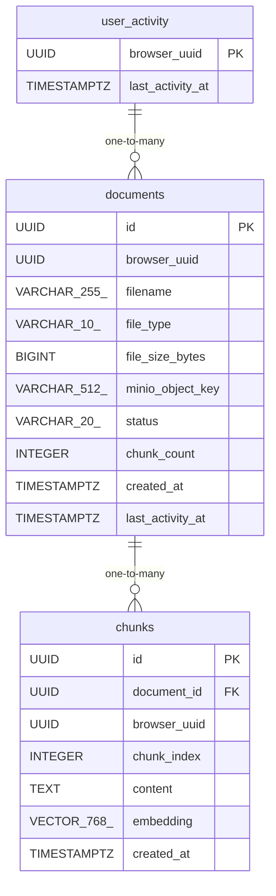

# Data Model

<!-- sdlc:auto:start entities -->
### documents

| Field | Type | PK | FK | Nullable |
|---|---|---|---|---|
| id | UUID | True | — | False |
| browser_uuid | UUID | False | — | False |
| filename | VARCHAR(255) | False | — | False |
| file_type | VARCHAR(10) | False | — | False |
| file_size_bytes | BIGINT | False | — | False |
| minio_object_key | VARCHAR(512) | False | — | False |
| status | VARCHAR(20) | False | — | False |
| chunk_count | INTEGER | False | — | True |
| created_at | TIMESTAMPTZ | False | — | False |
| last_activity_at | TIMESTAMPTZ | False | — | False |

### chunks

| Field | Type | PK | FK | Nullable |
|---|---|---|---|---|
| id | UUID | True | — | False |
| document_id | UUID | False | documents.id | False |
| browser_uuid | UUID | False | — | False |
| chunk_index | INTEGER | False | — | False |
| content | TEXT | False | — | False |
| embedding | VECTOR(768) | False | — | False |
| created_at | TIMESTAMPTZ | False | — | False |

### user_activity

| Field | Type | PK | FK | Nullable |
|---|---|---|---|---|
| browser_uuid | UUID | True | — | False |
| last_activity_at | TIMESTAMPTZ | False | — | False |
<!-- sdlc:auto:end entities -->

<!-- sdlc:auto:start relationships -->
| Source | Target | Type |
|---|---|---|
| documents | chunks | one-to-many |
| user_activity | documents | one-to-many |
<!-- sdlc:auto:end relationships -->

<!-- sdlc:auto:start er-diagram -->

<!-- sdlc:auto:end er-diagram -->
