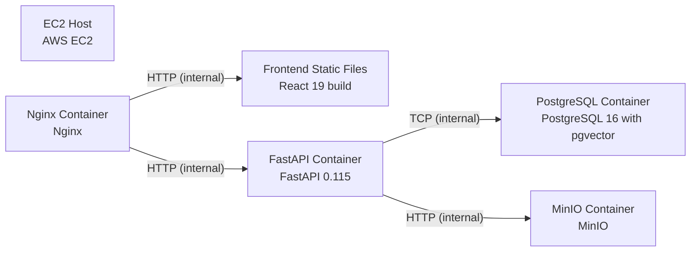

# Deployment Guide

> Maintained by QuorQ AI SDLC. Text between `sdlc:auto` markers is regenerated; anything outside them is yours and is kept.

<!-- sdlc:auto:start how-it-deploys -->
Pushes to `main` run `.github/workflows/deploy.yml`, which builds the API image (if there is a backend) and deploys the SPA to AWS Amplify. Commits touching only `docs/sdlc/**` don't deploy. Deployments can also be started from the platform's Deployment tab.
<!-- sdlc:auto:end how-it-deploys -->

<!-- sdlc:auto:start environments -->
| Name | Service | Runtime | Scaling | Environment |
|---|---|---|---|---|
| EC2 Host | AWS EC2 | Ubuntu 22.04 | single instance | dev |
| Nginx Container | Nginx | Docker | single container | dev |
| Frontend Static Files | React 19 build | Nginx-served static dist | single | dev |
| FastAPI Container | FastAPI 0.115 | Docker (uvicorn) | single container | dev |
| PostgreSQL Container | PostgreSQL 16 with pgvector | Docker | single container | dev |
| MinIO Container | MinIO | Docker | single container | dev |
<!-- sdlc:auto:end environments -->

<!-- sdlc:auto:start live -->
_Not deployed yet._
<!-- sdlc:auto:end live -->

<!-- sdlc:auto:start topology -->

<!-- sdlc:auto:end topology -->
