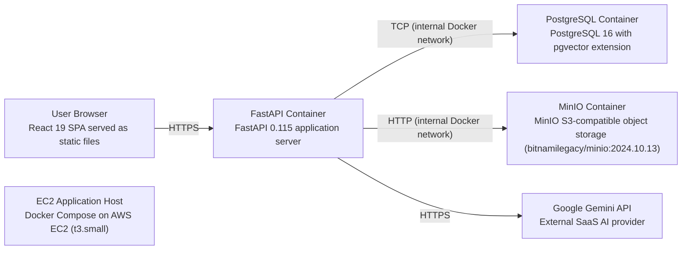

# Deployment Guide

> Maintained by QuorQ AI SDLC. Text between `sdlc:auto` markers is regenerated; anything outside them is yours and is kept.

<!-- sdlc:auto:start how-it-deploys -->
Pushes to `main` run `.github/workflows/deploy.yml`, which builds the API image (if there is a backend) and deploys the SPA to AWS Amplify. Commits touching only `docs/sdlc/**` don't deploy. Deployments can also be started from the platform's Deployment tab.
<!-- sdlc:auto:end how-it-deploys -->

<!-- sdlc:auto:start environments -->
| Name | Service | Runtime | Scaling | Environment |
|---|---|---|---|---|
| User Browser | React 19 SPA served as static files | Browser | N/A (client-side) | prod |
| EC2 Application Host | Docker Compose on AWS EC2 (t3.small) | Docker | Single instance | prod |
| FastAPI Container | FastAPI 0.115 application server | Docker (uvicorn) | Single container | prod |
| PostgreSQL Container | PostgreSQL 16 with pgvector extension | Docker | Single container | prod |
| MinIO Container | MinIO S3-compatible object storage (bitnamilegacy/minio:2024.10.13) | Docker | Single container | prod |
| Google Gemini API | External SaaS AI provider | SaaS | Managed by Google | prod |
<!-- sdlc:auto:end environments -->

<!-- sdlc:auto:start live -->
_Not deployed yet._
<!-- sdlc:auto:end live -->

<!-- sdlc:auto:start topology -->

<!-- sdlc:auto:end topology -->
